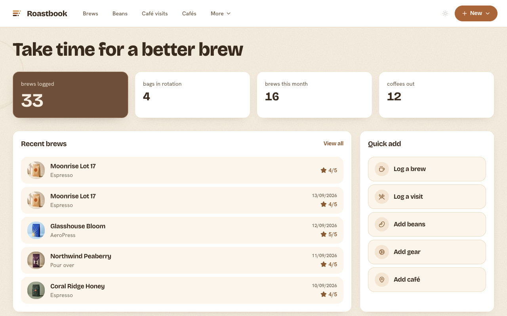
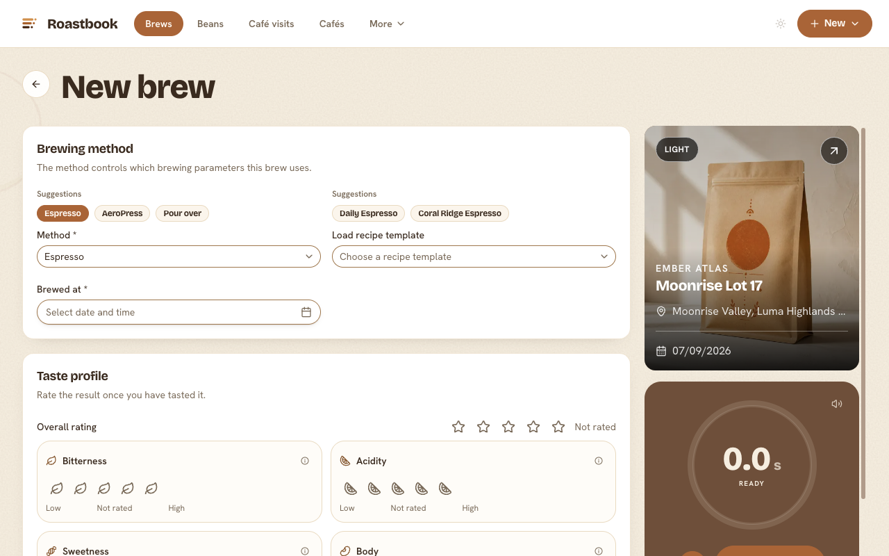
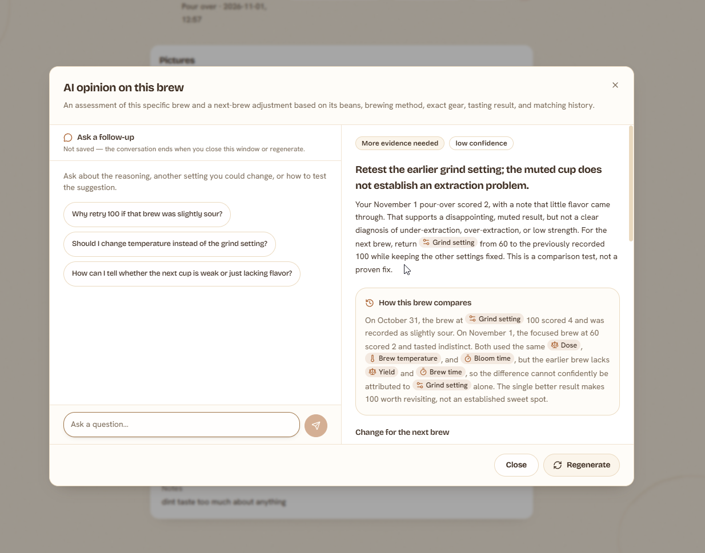
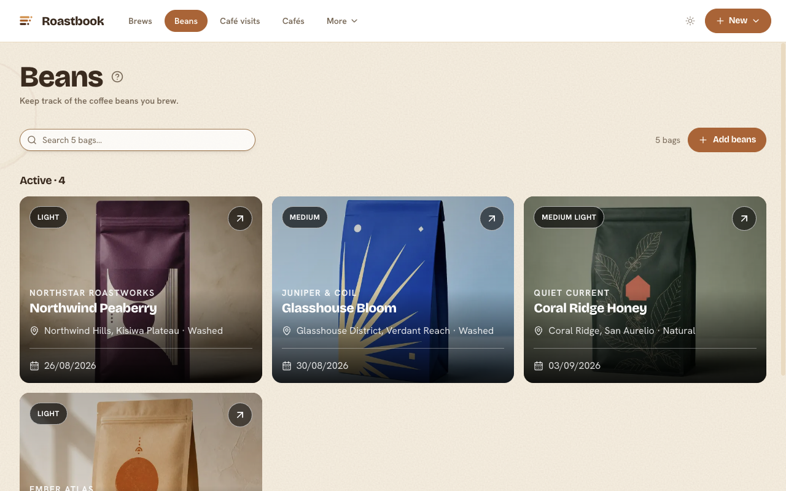

<!-- markdownlint-disable MD033 -->
<h1 align="center">
  <br>
  Roastbook
</h1>

<p align="center">
  <strong>The AI-native coffee journal you actually own.</strong><br>
  Photograph the bag. Log the brew. Keep every gram of data on your own
  infrastructure.
</p>

<p align="center">
  <a href="https://demo.roastbook.coffee/overview"><b>Open the demo</b></a>
  &nbsp;·&nbsp;
  <a href="#-quick-start">Quick start</a>
  &nbsp;·&nbsp;
  <a href="#-documentation">Documentation</a>
  &nbsp;·&nbsp;
  <a href="DESIGN.md">Design system</a>
</p>

<p align="center">
<a href="https://github.com/michidk/roastbook/actions/workflows/ci.yml">
</a>
<a href="https://app.codacy.com/gh/michidk/roastbook/dashboard">
</a>


</p>

<p align="center">
  <a href="https://roastbook.coffee/">
    
  </a><br>
  <sub>Real app screen with sample data, set in an AI-generated coffee scene.</sub>
</p>

---

> [!TIP]
> **Try it in ten seconds.** The
> [editable demo](https://demo.roastbook.coffee/overview) runs entirely in your
> browser with fictional sample data — no account, no server database. Changes
> stay in this browser only. AI recommendations and bean research use preset
> responses from the sample data without contacting an AI provider.

Beans form a coffee database with optional bag tracking, shelf placement, personal
ratings with brew-average fallback, and custom tags. Log a new café coffee inside
the visit form. See [Coffee database and bags](docs/beans.md).

## ☕ What it is

Roastbook is a self-hosted journal for your brews, beans, recipes, café visits,
roasters, brewing methods, and gear. Website:
[roastbook.coffee](https://roastbook.coffee/).

<p align="center">
  
</p>

- 🎚️ **Simple first, deep when you ask.** Each brewing method shows only its
  own fields; a quick entry takes dose, yield, and time. Pre-infusion,
  pressure, flow, temperature, grind, tamp, basket, puck screen, and filter
  position are there when you want them.
- 🤖 **AI where you already type.** Photograph a bag to read its label,
  research roasters and espresso machines, and get brew recommendations. Every
  value is validated, keeps its source, and is confirmed by you before saving.
- 🫘 **One coffee, every bag.** Repeat purchases add a bag to the same coffee;
  roast date, weight, price, and shop stay per bag while brew history and
  photos belong to the coffee.
- 📈 **Numbers that answer questions.** An activity calendar, filterable
  statistics, and parameter charts connect quality to beans, methods, gear,
  timing, and cost.
- 📴 **Installable and offline.** Use it in the browser or install it as a
  PWA. The installed app automatically keeps the journal on the device, works
  without a connection, and syncs only what changed when you reconnect. Browser
  tabs use the server unless this browser already has a journal copy.
  [See what works offline.](docs/offline.md)
- 🔒 **Yours, end to end.** Your own PostgreSQL and storage. Private accounts
  with email codes and passkeys, or one shared journal behind your own auth
  proxy.
- 🚀 **Deploys in one command.** Docker Compose for a home server, a Helm chart
  for a cluster.

<p align="center">
  
</p>

## 🧠 AI features

AI is optional; everything else works without it. Each user connects their
own OpenAI-compatible endpoint in **Settings → AI**. See
[AI configuration](docs/configuration.md).

- **Label scanning** — extract bean details from up to six pictures of a bag.
- **Bean, roaster, and machine research** — fill in origin, process, tasting
  notes, a roaster's website and location, or a machine's sourced capabilities
  and factory settings, with strict rules against weak evidence.
- **Brew recommendations** — compare a draft or logged brew with up to 50
  matching brews for the same bean, method, and gear, get one explained
  adjustment or experiment, and ask follow-up questions in a chat.
- **Request log** — see every AI request with its status, duration, and token
  usage in Settings, and optionally its raw inputs and responses for debugging.

<p align="center">
  
</p>

AI calls run server-side only and are rate-limited, schema-validated, and
logged in the database without image payloads.

> [!IMPORTANT]
> **API and MCP server for your own scripts and agents.** `/api/v1` is a REST
> API with generated OpenAPI request and response schemas and a public,
> interactive reference
> at `/api/v1/docs`, and `/api/mcp` a Streamable HTTP MCP
> endpoint; both can read and change everything in your journal, including
> pictures, but never administer accounts. API keys, MCP tokens, and MCP
> applications get per-resource read or write permissions and shared rate
> limits; keys and tokens also expire (seven days unless you choose longer).
> Manage them in **Settings → API** and **Settings → AI access (MCP)**. See
> [API](docs/api.md) and [Deployment](docs/deployment.md#mcp).

## 📦 Features

<details>
<summary><b>The complete feature list</b></summary>

### Brewing

- Log brews with dose, yield, time, equipment, ratings, and flavor notes.
- Recipes as editable templates with drink options, gear-set matching, and a
  target brew time for the brew timer. Brews keep their own snapshot.
- Optionally receive brew times from a Wi-Fi
  [shottimer](https://github.com/michidk/shottimer).

### Taste

- Switch the overall rating, each sensory factor, flavor tags, and tasting
  notes on or off, or use a single sour-to-bitter scale.

### Your coffee world

- Coffees with bag history, roasters, brewing methods, coffee shops, typed
  gear, and reusable gear sets.
- Café visits on a map and a Places list from favorites to wishlist.
- Configurable drink and milk types per brewing method.

<p align="center">
  
</p>

### Insight and navigation

- Filterable trends for quality, consistency, taste, rhythm, recipes, gear,
  and cost.
- A <kbd>⌘</kbd> <kbd>K</kbd> / <kbd>Ctrl</kbd> <kbd>K</kbd> command palette
  for search, navigation, and quick actions.
- Six light and dark palettes, with optional paper grain and coffee stains, in
  **Settings → Appearance**.

### Self-hosting

- Local or S3-compatible media storage with a per-journal storage allowance.
- Passwordless private accounts or one shared journal behind Hodor.
- An Admin page for users and roles, with each account's agreements,
  passkeys, sessions and usage; data export and confirmed account deletion.

</details>

## 🧱 Tech stack

| Layer | Choice |
| --- | --- |
| Runtime and package manager | Bun 1.4.4 |
| Framework and routing | TanStack Start and TanStack Router |
| UI | React 19, shadcn/ui, Tailwind CSS v4, Lucide, MapLibre GL |
| Database | PostgreSQL on the server; PGlite in the browser |
| Media storage | Local filesystem or S3-compatible buckets |
| AI | TanStack AI with any OpenAI-compatible endpoint |
| Validation | Zod at every boundary |
| Authentication | Better Auth (email codes, passkeys); optional Hodor |
| Tooling | Vite, Biome, Knip, `bun test` |
| Deployment | Docker Compose or Helm |

## 🚀 Quick start

Docker Compose starts PostgreSQL, applies migrations, and serves Roastbook
behind Hodor.

```bash
cp .env.example .env
# Replace HODOR_PASSWORD and HODOR_SECRET in .env.
# Generate a signing secret with: openssl rand -hex 32
docker compose up --build
```

Open <http://localhost:3000> after the migration completes.

For private accounts, set `PUBLIC_URL`, `AUTH_SECRET`, email delivery, and
`AUTH_ADMIN_EMAIL` (your own email address) in `.env`, then run
`docker compose -f docker-compose.auth.yaml up --build`. Only addresses in
`AUTH_ADMIN_EMAIL` become administrators, and the first of them to sign in takes
over an existing shared journal. See
[Configuration](docs/configuration.md) and [Deployment](docs/deployment.md),
including upgrade steps for an existing journal.

## 🔧 Local development

With PostgreSQL available at the `DATABASE_URL` from `.env`:

```bash
bun install --frozen-lockfile
cp .env.example .env
bun run dev
```

The development server listens on <http://localhost:3000> and applies pending
migrations on start. See [Development and testing](docs/development.md).

<details>
<summary><b>All available commands</b></summary>

| Command | Purpose |
| --- | --- |
| `bun run dev` | Apply migrations and start the development server |
| `bun run storybook` | Browse component stories on port 6006 |
| `bun run build:storybook` | Build the static component library |
| `bun run check` | Check formatting, lint, and Markdown |
| `bun run typecheck` | Run TypeScript without emitting files |
| `bun run test` | Run tests; report unavailable integrations as skipped |
| `bun run test:integration` | Require PostgreSQL and S3 integration tests |
| `bun run lint:deadcode` | Find unused code and dependencies with Knip |
| `bun run build` | Build production assets |
| `bun run dev:demo` | Run the browser-local demo |
| `bun run build:demo` | Build the static browser-local demo |
| `bun run verify` | Run the complete local quality gate |
| `bun run db:generate` | Generate a Drizzle migration after a schema change |
| `bun run db:migrate` | Apply committed migrations |
| `bun run db:studio` | Open Drizzle Studio |
| `bun run db:seed` | Seed the demo's fictional dataset |
| `bun run storage:orphans` | Report media drift without changing data |

</details>

## 📚 Documentation

| Guide | What is inside |
| --- | --- |
| [Development and testing](docs/development.md) | Workflow, tests, tooling |
| [Configuration reference](docs/configuration.md) | Every environment variable |
| [Deployment](docs/deployment.md) | Docker, Helm, security boundary, MCP |
| [Upgrading](docs/upgrading.md) | Required changes for the multi-user release |
| [Offline journaling](docs/offline.md) | Offline coverage, sync, and conflicts |
| [Browser-local demo](docs/demo-mode.md) | Demo data, restrictions, and builds |
| [Journal architecture](docs/client-data.md) | Journal functions, local database, sync |
| [API](docs/api.md) | REST API, keys, permissions, rate limits |
| [Shottimer API](docs/shottimer.md) | Device integration endpoints |
| [Design system](DESIGN.md) | Layout contract and UI conventions |
| [Design files](design/README.md) | Editable OpenPencil views |
| [Helm chart reference](charts/README.md) | Chart values and defaults |

## 📁 Project layout

```text
src/routes/          TanStack Router file routes and server endpoints
src/components/      Shared application and domain UI
src/components/ui/   shadcn/ui primitives
src/journal/         SQL journal functions, shared by browser and server
src/lib/server/      Server-side domain operations
src/lib/storage/     Local and S3-compatible storage providers
src/db/              Drizzle schemas and database connection
packages/            Demo edition package
drizzle/             Committed migrations and metadata
charts/              Helm chart
```

## 📄 License

[MIT](LICENSE)

Release maintainers can run the **Release** GitHub Action with an automatic
Conventional Commit version bump or an explicit override. See
[releases](docs/deployment.md#releases) for the publication and image build flow.

## Shared UI

The app imports shadcn primitives and theme tokens from
[`@roastbook/ui`](https://github.com/roastbook/ui), pinned to a Git commit in
`package.json` and `bun.lock`. Add shared primitives in that repository.
The app keeps its feature components, preferences and document layout locally.
The existing UI stories render the shared package components.
